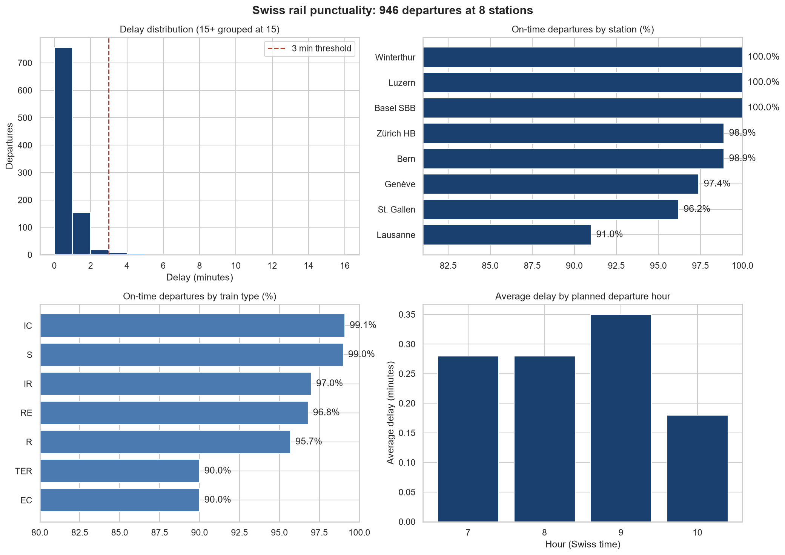
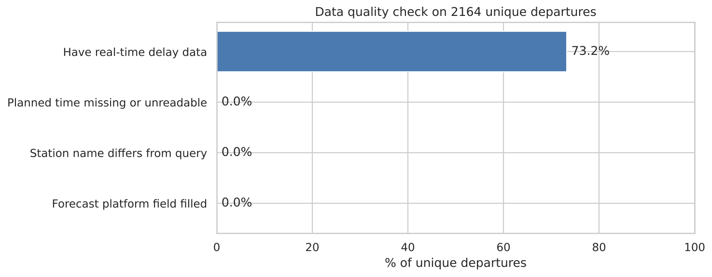

# Swiss Rail Punctuality and API Data Quality

Live analysis of train departures at 8 major Swiss stations, collected from the public Swiss transport REST API ([transport.opendata.ch](https://transport.opendata.ch)). The pipeline pulled real-time departure boards every 15 minutes during the morning rush, audited the data the way a partner integration team would, and measured punctuality by station, train type and hour.

**Tools:** Python, requests (REST API), Pandas, Matplotlib, Seaborn, Jupyter Notebook
**Data:** 12 live snapshots on 26 October 2026, 07:06 to 10:00 Swiss time: 14,420 rows, 2,164 unique departures, 946 analysed
**Stations:** Zürich HB, Bern, Basel SBB, Genève, Lausanne, Luzern, Winterthur, St. Gallen

---

## Dashboard



---

## Key findings

1. **98.1% of 946 departures left on time** (less than 3 minutes late, SBB's threshold). Average delay was 0.29 minutes, 0.6% of departures were 5 or more minutes late, and the largest delay was 13 minutes.
2. **Lausanne was the weakest station at 91.0% on time**, about 8 points below Bern and Zürich HB (both 98.9%). Genève was also below average at 97.4%, so the Lake Geneva corridor stood out. Basel SBB, Luzern and Winterthur ran at 100%.
3. **Cross-border trains were the least punctual.** EuroCity (EC) and French regional TER services both ran at 90% on time, and TER averaged 1.6 minutes of delay, more than five times the S-Bahn's 0.28 minutes. Samples were small (10 departures each), so this is a pattern to test with more data. Domestic IC (99.1%) and S-Bahn (99.0%) trains were the most reliable.
4. **Punctuality dipped in the 09:00 hour** to 96.9%, from 98.3% at 07:00 and 98.4% at 08:00.

---

## Data quality audit



| Finding | What it means for a partner integrating this API |
| --- | --- |
| 26.8% of unique departures (580 of 2,164) had no real-time delay value | Treat a missing delay as "no live data", never as "on time" |
| Departures further ahead often show a delay of 0 because nothing has happened yet. A first test run without filtering returned 100% on time | Only trust delay values for departures close to leaving |
| The forecast platform field was empty in all 14,420 rows | Platform changes cannot be detected from this endpoint, even though the field exists in the response |
| A query for "Geneva" returns "Genève" | Match stations by ID, not by name |
| `x` holds latitude (46.21) and `y` holds longitude (6.14) for Genève | Swap them before plotting stations on a map |

---

## Method

1. `get_json` calls the API, checks the status code and retries on 5xx errors and timeouts. 4xx errors are not retried, because the request itself is wrong
2. `flatten_departure` turns each nested JSON departure into one table row
3. 12 snapshots, 15 minutes apart, each saved to CSV straight away
4. Duplicates across snapshots removed, keeping the latest value per departure (14,420 rows to 2,164 departures)
5. Only departures within 15 minutes of leaving at snapshot time are analysed, because further-ahead departures report a delay of 0 by default
6. Punctuality calculated against the 3-minute threshold and grouped by station, train type and hour

## Limitations

One morning of data from one day. EC and TER samples are small. A longer collection over several weekdays would confirm whether the Lausanne and cross-border patterns hold.

## Run it yourself

```
pip install -r requirements.txt
jupyter notebook Swiss_Rail_Punctuality_Analysis.ipynb
```

Set `SNAPSHOTS = 1` in the setup cell for a quick test run.